<!-- Upload README.md, images/ and .github/workflows/ to the root of Rezansrv/Rezansrv. -->
<p align="center">
  <picture>
    <source media="(max-width: 600px) and (prefers-color-scheme: light)" srcset="images/hero-mobile-light.svg" />
    <source media="(max-width: 600px)" srcset="images/hero-mobile-dark.svg" />
    <source media="(prefers-color-scheme: dark)" srcset="images/hero-dark.svg" />
    <source media="(prefers-color-scheme: light)" srcset="images/hero-light.svg" />
    
  </picture>
</p>

<p align="center">
  <strong>Front-end · AI · SQL &amp; SQL Server</strong><br />
  Building interfaces and working with intelligent tools and data.
</p>

<p align="center">
  <a href="https://rezansrv.ir/">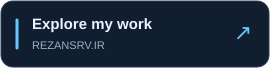</a>
  <a href="https://github.com/Rezansrv?tab=repositories">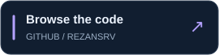</a>
  <a href="https://www.linkedin.com/in/reza-naserivand/">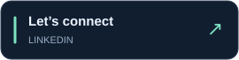</a>
</p>

<br />

## 01 / Behind the interface

Hey, I’m **Reza Naserivand** — a software developer working across **front-end development, AI, SQL, and SQL Server**.

On the interface side, I work with **Vue and React**, along with **Nuxt and Next.js**. My toolkit also includes TypeScript, JavaScript, Sass, state management with Vuex and Redux, and testing with Jest. I also work with **AI and databases**, using SQL and SQL Server.

I like turning ideas into things people can use — from the interface they see to the data behind it.

```ts
const reza = {
  role: "Software developer",
  focus: ["Front-end", "AI", "SQL Server"],
  ecosystems: ["Vue", "React"],
  languages: [
    "TypeScript", "JavaScript",
    "Python", "C++",
  ],
  portfolio: "https://rezansrv.ir",
};
```

## 02 / Tools of the trade

**Languages**

<p>
  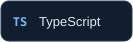
  
  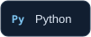
  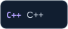
</p>

**Interface &amp; styling**

<p>
  
  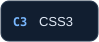
  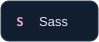
</p>

**Frameworks &amp; libraries**

<p>
  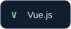
  
  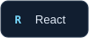
  
  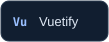
</p>

**AI &amp; data**

<p>
  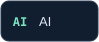
  
  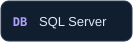
</p>

**State management**

<p>
  
  
</p>

**Testing &amp; workflow**

<p>
  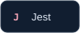
  
  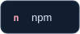
  
</p>

## 03 / GitHub, in motion

<p>
  <a href="https://github.com/Rezansrv"></a>
  <a href="https://github.com/Rezansrv?tab=repositories"></a>
</p>

<sub>Public GitHub activity · Language distribution reflects repository code, not proficiency.</sub>

### A little play between commits

My contribution graph, reimagined as a Breakout animation.

<picture>
  <source media="(prefers-color-scheme: dark)" srcset="images/breakout-dark.svg" />
  <source media="(prefers-color-scheme: light)" srcset="images/breakout-light.svg" />
  
</picture>

<br />

<p align="center">
  <picture>
    <source media="(max-width: 600px) and (prefers-color-scheme: light)" srcset="images/typing-light-mobile.svg" />
    <source media="(max-width: 600px)" srcset="images/typing-dark-mobile.svg" />
    <source media="(prefers-color-scheme: light)" srcset="images/typing-light.svg" />
    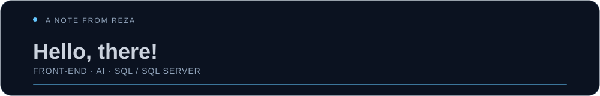
  </picture>
</p>

<a href="https://www.linkedin.com/in/reza-naserivand/">
  
</a>

<p align="center"><sub>Thanks for stopping by. Have a look around the repositories.</sub></p>
